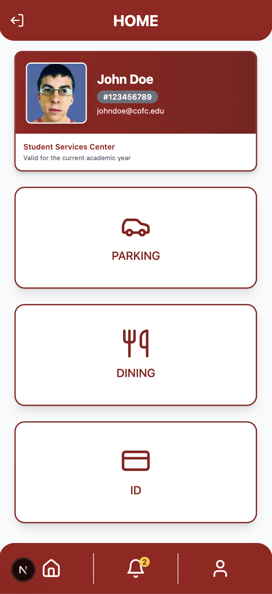
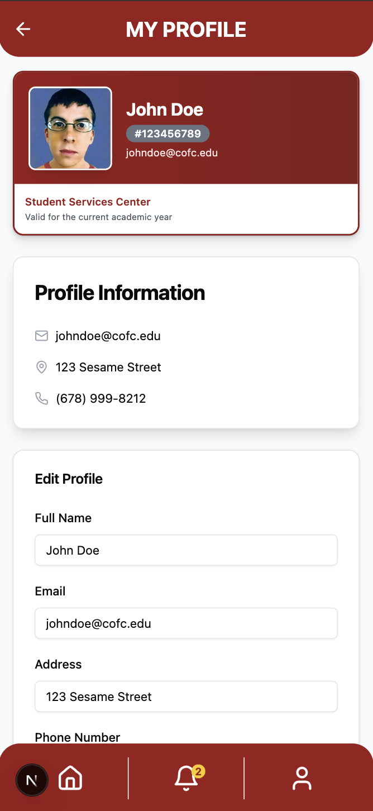
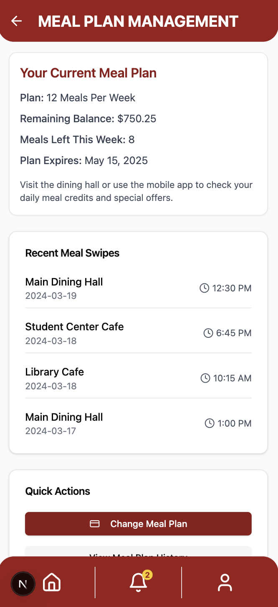
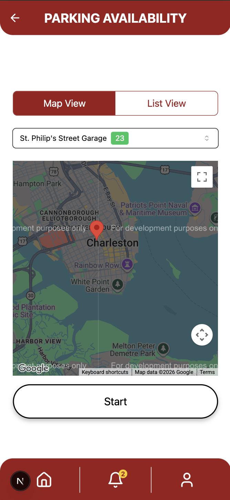

# Student Service Center

A full-stack web app that centralizes the everyday services a college student juggles across a dozen separate systems — student ID, meal plans, dining, and parking — into a single mobile-first interface. Built by a five-person team for **CSIS 672: Human-Computer Interaction** (Fall 2024, College of Charleston), the project moved from user interviews and personas through wireframes and usability testing to a working Next.js application backed by SQLite.

## Screenshots

<table>
  <tr>
    <td width="50%"></td>
    <td width="50%"></td>
  </tr>
  <tr>
    <td align="center"><sub>Home — digital ID + service shortcuts</sub></td>
    <td align="center"><sub>Profile — ID card and account details</sub></td>
  </tr>
  <tr>
    <td width="50%"></td>
    <td width="50%"></td>
  </tr>
  <tr>
    <td align="center"><sub>Dining — meal plan balance and swipe history</sub></td>
    <td align="center"><sub>Parking — live availability on an interactive map</sub></td>
  </tr>
</table>

## Key Features

- **Digital student ID** — ID card with photo, ID number, and account status, plus a flow for requesting a new or replacement card with pickup or delivery
- **Meal plan management** — current plan and balance, weekly meal count, swipe history, and the ability to browse and switch plans
- **Dining** — weekly meal schedules and plan options pulled from the dining hall data
- **Parking** — real-time garage availability on an interactive Google Maps view (with a list-view fallback), permit pass issuance/return, and paying outstanding parking tickets
- **Unified checkout** — a shared multi-step shipping/billing/payment flow used for both meal plan purchases and ID orders
- **Notifications** — an in-app notification center with an unread-count badge
- **Authentication** — email/password login with bcrypt-hashed credentials against a SQLite-backed user table

Several pages exist in both a static/mock-data version and a `-db` variant wired to the SQLite API routes — a byproduct of iterating the UI ahead of the backend during the course sprint.

## Process

The design was driven by primary research, not assumptions: the team conducted structured user interviews and built personas (see [`docs/coursework/`](docs/coursework/)) to understand how students actually navigate parking, dining, and ID services day to day. Screen flows were prototyped in **Figma** and **Vercel v0**, then validated with usability tests, with each round of feedback feeding back into the interface before the team moved to implementation.

## Tech Stack

- **Framework:** Next.js 15 (Pages Router), React 18, TypeScript
- **UI:** Tailwind CSS, shadcn/ui + Radix primitives, Framer Motion, lucide-react
- **Data:** SQLite (`sqlite` / `sqlite3`), bcrypt for password hashing
- **Maps:** Google Maps JavaScript API (`@react-google-maps/api`)
- **Deployment:** Vercel, with GitHub Actions handling preview and production deploys

## Getting Started

The application lives in [`app/ssc`](app/ssc).

```bash
cd app/ssc
npm install
npm run dev
```

The app runs at `http://localhost:3000`. The SQLite database is created and seeded automatically on first API call (see `src/database.js`). To use the parking map, add a Google Maps API key to `app/ssc/.env.local`:

```
NEXT_PUBLIC_GOOGLE_MAPS_API_KEY=your_key_here
```

Other useful scripts (run from `app/ssc`): `npm run build`, `npm run lint`, `npm run type-check`.

## Team

Built by Eric Wnorowski (Full-Stack Developer), Dan Johnson, Adaora Onwumelu, and teammates hazelwood-dal and lwilli13, for CSIS 672 at the College of Charleston.
